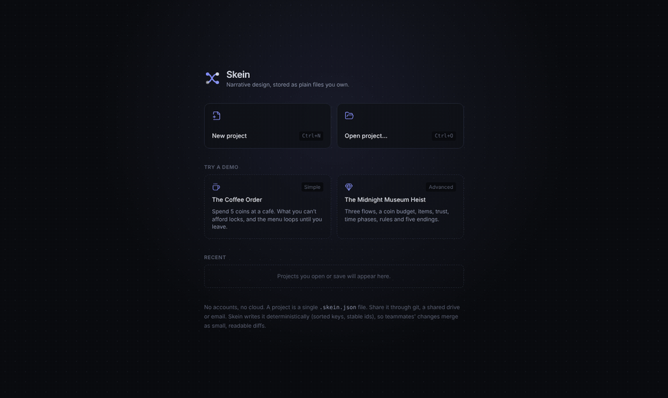
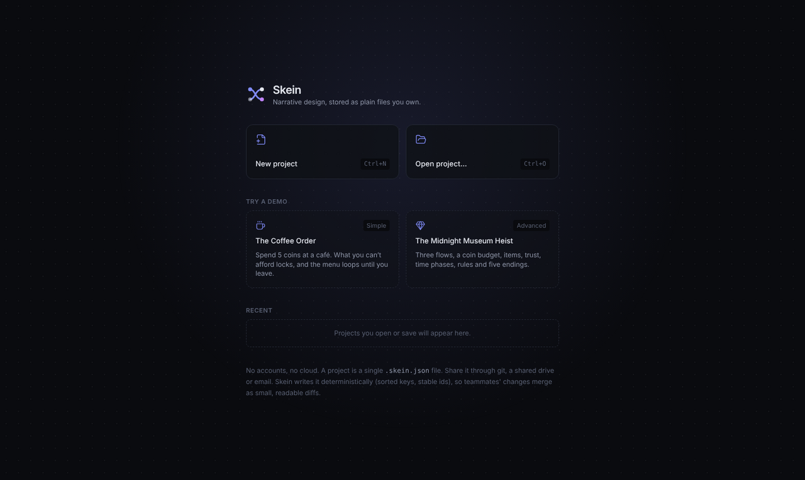
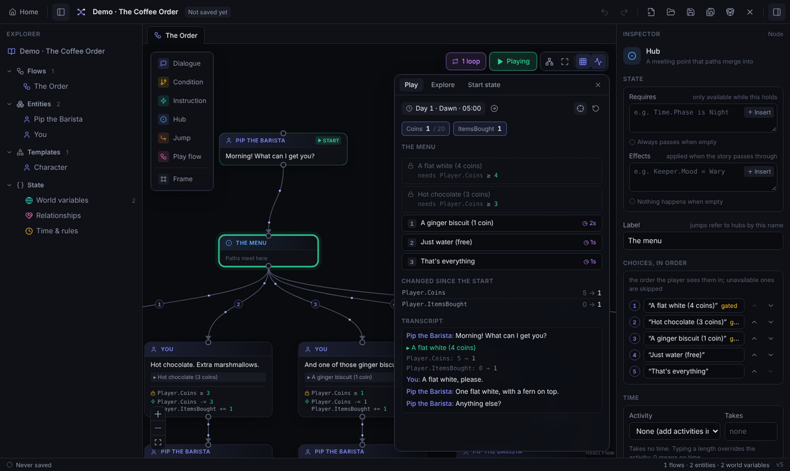
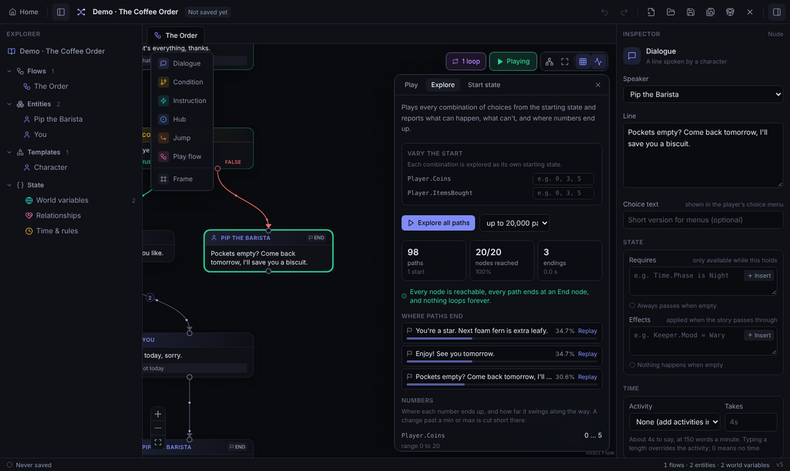
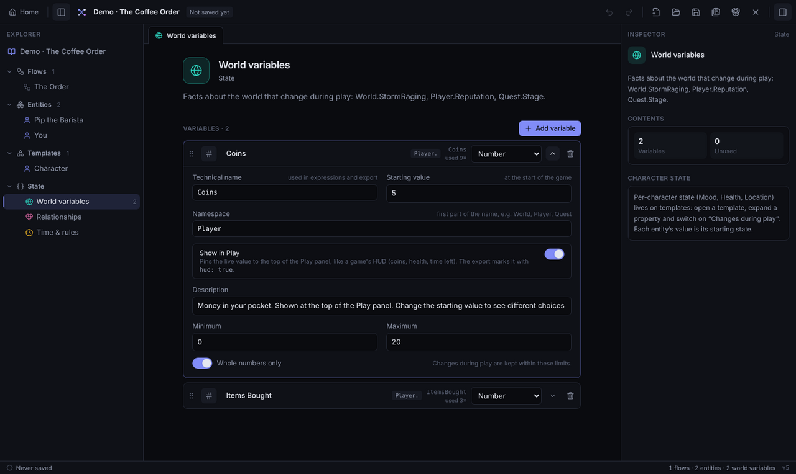

<div align="center">

# 🧶 Skein

**Write branching stories as flowcharts, test every path, and ship them to your game.**

A free, local-first narrative design editor for game writers and designers,
in the spirit of articy:draft, with no accounts and no cloud lock-in.

[](https://skein-mocha.vercel.app)

[](https://github.com/charlfourie/skein/actions/workflows/ci.yml)
[](https://github.com/charlfourie/skein/commits/main)




</div>

## What is Skein?

Skein is a node-based editor for **interactive dialogue and branching narrative**. You
lay out conversations as a flowchart, give your world state (coins, trust, time of day),
and Skein checks your logic as you type. Then you **play the story right in the editor**
and let it **explore every possible path** before a single line ships.

It's built for:

- 🎮 **Game writers and narrative designers** who want articy-style structure without the price tag or the lock-in.
- 🛠️ **Indie developers** who need dialogue, quests and state that drop straight into Unity, Godot or a JS game.
- 🤝 **Small teams** who share work through git: a project is one tidy JSON file that diffs and merges cleanly.

> **Not sure it fits?** If your story branches, remembers things, or runs on a clock, Skein
> is for you. If it's a straight line of text, a word processor will do.

## ✨ Features

| | |
| --- | --- |
| 🗺️ **Flowchart editor** | Dialogue, conditions, hubs, jumps and reusable scenes on an infinite canvas, with auto-layout, frames and live warnings for dead ends and orphans. |
| 🧠 **Real game state** | World variables, character stats, one-way relationships (who trusts whom), dice, and a clock where actions take time. Expressions are checked as you type, with "did you mean…?" suggestions. |
| ▶️ **Play mode** | Click through any flow exactly as the game will run it, with live state, a transcript, and a HUD for values like coins. Choices you can't afford show as locked, with the reason. |
| 🔍 **Explore every path** | Plays every combination of choices and reports endings, unreachable nodes, loops with no way out, and where numbers end up. |
| 📦 **Engine export** | Clean, deterministic JSON with every condition pre-compiled, plus ready-made runtimes for **TypeScript**, **C#** (Unity, Godot .NET, .NET) and **Unity components**. |
| 🔒 **Yours, on your disk** | No accounts, no server. Files are written atomically, repaired after messy merges, and watched for `git pull` changes. |
| 🌐 **Desktop or browser** | An Electron desktop app, or the same editor [in your browser](https://skein-mocha.vercel.app). |

## 🚀 Quick start

### Fastest: in your browser

Open **[skein-mocha.vercel.app](https://skein-mocha.vercel.app)** and pick a demo under
**Try a demo**. Nothing to install. Chrome, Edge, Brave and Arc read and save files in
place; Firefox and Safari open by upload and save by download. See [docs/WEB.md](docs/WEB.md).

### Desktop app

Requires [Node.js](https://nodejs.org) 20 or newer.

```bash
git clone https://github.com/charlfourie/skein.git
cd skein
npm install
npm run dev
```

The app opens on the Welcome screen. Pick a demo, or **New project** to start your own.

## 🎬 A five-minute tour

The two built-in demos have nothing to do with any particular game, so they're a safe
place to poke around. Demos open as unsaved copies, so experiment freely. **Home** (top
left) takes you back to the Welcome screen at any time.



**1. ☕ The Coffee Order (simple).** You have 5 coins at Pip's café. Open the flow, press
**Play** (top right of the canvas) and order something. Your coins tick down in the HUD,
and anything you can no longer afford stays on the menu, locked, showing what it needs.



**2. 🔍 Explore it.** Switch to the **Explore** tab and press **Explore all paths**. Skein
plays every possible order and tells you where each one ends, whether any node is
unreachable, and how low your coins can go.



**3. 💎 The Midnight Museum Heist (advanced).** Three linked scenes: plan the job, pull it
off, then make the getaway. It shows items, trust between characters, a stat that
drops at dawn, time phases with rules, and five endings. With 5 coins you can afford
cat treats **or** a bribe for the guard, but not both.

**4. 🧮 Look under the hood.** Open **State › World variables** to see how `Player.Coins`
is defined. **Show in Play** is what puts it in the HUD.



The full coin matrix for both demos (what's offered at every coin amount) is in
[docs/DEMOS.md](docs/DEMOS.md).

## ✍️ Writing logic

Conditions and actions use a small, checked language:

```text
# Conditions: one true/false expression
Player.Coins >= 4
Keeper->Stranger.Trust >= 2 and not World.StormRaging
Time.Phase is Night or Time.Day > 3
Seen.AskedAboutLight                  # true once a tagged node has played

# Actions: one change per line
Player.Coins -= 4
Keeper.Mood = Warm
World.Lucky = chance(30)              # dice, seeded and explorable
pass 1h 30m                           # let time go by
advance until Night
```

Rename a variable and every expression that uses it follows along. The
[user guide](docs/GUIDE.md) covers everything.

## 🎮 Using it in your game

Press **Ctrl+E** (or **File › Export for Game Engine…**) for a clean JSON file, or export
from a build pipeline:

```bash
npm run export -- story.skein.json build/story.game.json
```

Then play it with a runtime. In **Unity**:

```csharp
using Skein.Unity;

var skein = SkeinRunner.Instance;
skein.Play("The Order");                       // a flow, by name
skein.BeatChanged += beat => ShowLine(beat.Speaker, beat.Text, beat.Choices);
skein.Choose(0);

int coins = (int)skein.World.GetNumber("Player.Coins");
PlayerPrefs.SetString("save", skein.SaveToJson());
```

| Runtime | Where | Use it for |
| --- | --- | --- |
| TypeScript reference | [`src/shared/export/runtime.ts`](src/shared/export/runtime.ts) | Web and JS/TS games, or as the spec to port from |
| C# | [`runtimes/csharp`](runtimes/csharp) | Unity, Godot .NET, plain .NET. Checked against the reference by a conformance suite. |
| Unity components | [`runtimes/unity`](runtimes/unity/Skein/README.md) | Drop-in runner, talk triggers, dialogue box, clock and variable events |

The format is fully specified in [docs/EXPORT.md](docs/EXPORT.md).

## 🗺️ Roadmap

Skein is built in reviewed phases. Phases 1 to 5 built the editor. The next ones turn it
into a tool any team can adopt.

| | Phase | Status |
| --- | --- | --- |
| ✅ | **1–5 · The editor:** storage, templates and entities, flowcharts, state and time, engine export | Done |
| 🟡 | **6 · Engine runtimes:** C# and Unity are done; a native Godot (GDScript) add-on is next | In progress |
| 🟡 | **7 · Play and analysis:** Play, Explore, start states and replays are done; saved test runs that re-check after edits are next | In progress |
| ⬜ | **8 · Collaboration:** one file per flow for fewer conflicts, GitHub sign-in, comments on nodes | Planned |
| ⬜ | **9 · Localisation and voice-over:** line IDs, translator export and import, recording scripts | Planned |
| ⬜ | **10 · Extensibility:** custom node types, event nodes, variables inside lines, plugins | Planned |
| ⬜ | **11 · Interchange:** import from ink, Yarn Spinner and Twine; templates beyond games | Planned |
| ⬜ | **12 · Adoption:** published JSON Schema, a CLI, a docs site, more samples | Planned |

Through every phase Skein stays **local-first** (it always works offline, with files you
own), keeps **deterministic files** that diff cleanly, and has **one source of truth** for
story logic that every runtime is tested against.

See what's changed recently in the [changelog](CHANGELOG.md).

## 📚 Documentation

| Doc | What's in it |
| --- | --- |
| [User guide](docs/GUIDE.md) | Templates, entities, flows, state, the expression language, time, export |
| [Play and Explore](docs/PLAY.md) | Testing flows, start states, path exploration |
| [Demos](docs/DEMOS.md) | The two demos and their full choice matrices |
| [Export format](docs/EXPORT.md) | The game export, and exactly how a story runs |
| [Architecture](docs/ARCHITECTURE.md) | Code layout, the project file, and why it merges cleanly |
| [Web build](docs/WEB.md) | Running Skein in a browser and deploying it |

## 🤝 Contributing

Skein is young and contributions are very welcome, whether that's a bug report, a demo
idea, docs, or code. Read [CONTRIBUTING.md](CONTRIBUTING.md) to get set up; the short
version:

```bash
npm install
npm run typecheck && npm test   # before you open a pull request
```

Found a bug or have an idea? [Open an issue](https://github.com/charlfourie/skein/issues).

## 💜 Acknowledgements

Skein is created and maintained by [Charl Fourie](https://github.com/charlfourie), with
help from Claude. It stands on the shoulders of
[React Flow](https://reactflow.dev), [dagre](https://github.com/dagrejs/dagre),
[Electron](https://www.electronjs.org), [Zod](https://zod.dev),
[Zustand](https://github.com/pmndrs/zustand), [Immer](https://immerjs.github.io/immer/)
and [Lucide](https://lucide.dev), and takes its cue from
[articy:draft](https://www.articy.com).

## 📄 License

A license hasn't been chosen yet, so for now all rights are reserved. Please
[open an issue](https://github.com/charlfourie/skein/issues) if you'd like to use Skein in
your project.

---

<div align="center">

**Ready to write something that branches?**

[**Try Skein in your browser**](https://skein-mocha.vercel.app) · ⭐ **Star the repo** to follow along · 🤝 **[Contribute](CONTRIBUTING.md)**

</div>
