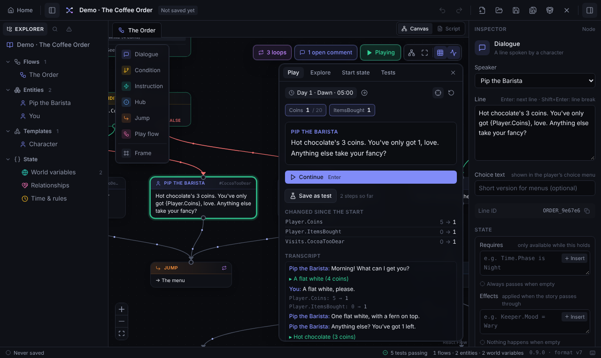

<div align="center">

# 🧶 Skein

**Write branching stories as flowcharts, test every path, and ship them to your game.**

A free, local-first narrative design editor for game writers and designers,
in the spirit of articy:draft, with no accounts and no cloud lock-in.

[](https://skein.charl.space)

[](https://github.com/charlfourie/skein/actions/workflows/ci.yml)
[](https://github.com/charlfourie/skein/commits/main)
[](LICENSE)
[](runtimes/LICENSE)


</div>

## What is Skein?

Skein is a node-based editor for **interactive dialogue and branching narrative**. You
lay out conversations as a flowchart, give your world state (coins, trust, time of day),
and Skein checks your logic as you type. Then you **play the story right in the editor**
and let it **explore every possible path** before a single line ships.

It's built for:

- 🎮 **Game writers and narrative designers** who want articy-style structure without the price tag or the lock-in.
- 🛠️ **Indie developers** who need dialogue, quests and state that drop straight into Unity, Godot or a JS game.
- 🤝 **Small teams** who share work through git: a project is a folder with one tidy JSON file per flow, so it diffs and merges cleanly.

> **Not sure it fits?** If your story branches, remembers things, or runs on a clock, Skein
> is for you. If it's a straight line of text, a word processor will do.

## ✨ Features

| | |
| --- | --- |
| ✍️ **Fast to write in** | Press Enter to write the next line (speakers alternate by themselves), read and edit a flow as a script, paste a scene written anywhere as connected lines, copy and paste nodes between projects, and get unsaved work back after a crash. |
| 🔎 **Search and Problems** | Find and replace across every line, condition and note (with regular expressions, and a preview that refuses replacements that would break logic), and one list of every error, warning and failing test. |
| 🗺️ **Flowchart editor** | Dialogue, conditions, hubs, jumps and reusable scenes on an infinite canvas, with auto-layout, frames and live warnings for dead ends and orphans. |
| 🧠 **Real game state** | World variables, character stats, one-way relationships (who trusts whom), dice, and a clock where actions take time. Expressions are checked as you type, with "did you mean…?" suggestions. |
| ▶️ **Play mode** | Click through any flow exactly as the game will run it, with live state, a transcript, and a HUD for values like coins. Choices you can't afford show as locked, with the reason. |
| 🔍 **Explore every path** | Plays every combination of choices and reports endings, unreachable nodes, loops with no way out, and where numbers end up. |
| 🧪 **Story tests** | Save a play-through or an every-path check, with conditions that must hold. Tests re-run after every edit and in your build pipeline, so a change that breaks the story shows up straight away. |
| 📦 **Engine export** | Clean, deterministic JSON with every condition pre-compiled, plus ready-made runtimes for **TypeScript**, **C#** (Unity, Godot .NET, .NET) and **Unity components**. |
| 🎙️ **Ready for voice and translation** | Every line has a stable line ID, and lines can show live values: `You've got {Player.Coins} left.` |
| 💬 **Made for teams** | Comment threads on any node, and one file per flow, so people working on different scenes never collide in git. |
| 🔒 **Yours, on your disk** | No accounts, no server. Files are written atomically, repaired after messy merges, and watched for `git pull` changes. |
| 🌐 **Runs in your browser** | Nothing to install. [Open it](https://skein.charl.space) and work on files on your own disk. Chrome, Edge and Arc open and save project folders; Firefox and Safari use single files. |

## 🚀 Quick start

Open **[skein.charl.space](https://skein.charl.space)** and pick a demo under
**Try a demo**, or **New project** to start your own. Nothing to install, and no account.

Skein reads and writes files on your own computer: nothing you write is uploaded. Chrome,
Edge, Brave and Arc open and save project folders in place; Firefox and Safari open a
single file by upload and save it by download. See [docs/WEB.md](docs/WEB.md). The hosted
version counts anonymous visits (no cookies, nothing from your projects).

### Run your own copy

Skein is a static web page, so you can run it yourself, offline or on your own server.
Requires [Node.js](https://nodejs.org) 20 or newer.

```bash
git clone https://github.com/charlfourie/skein.git
cd skein
npm install
npm run dev        # http://localhost:5173, with hot reload
npm run build      # a static site in dist/, for any web server
```

## 🎬 A five-minute tour

The two built-in demos have nothing to do with any particular game, so they're a safe
place to poke around. Demos open as unsaved copies, so experiment freely. **Home** (top
left) takes you back to the Welcome screen at any time.


**1. ☕ The Coffee Order (simple).** You have 5 coins at Pip's café. Open the flow, press
**Play** (top right of the canvas) and order something. Your coins tick down in the HUD.
Order something you can't afford and a condition catches it: Pip tells you the price and
what you've got, nothing is spent, and you're back at the menu to pick again. The tip jar
on the way out works the same way. (For choices that simply lock when you can't afford
them, see the bribe in the Museum Heist.)



**2. 🔍 Explore it.** Switch to the **Explore** tab and press **Explore all paths**. Skein
plays every possible order and tells you where each one ends, whether any node is
unreachable, and how low your coins can go.


**3. 💎 The Midnight Museum Heist (advanced).** Three linked scenes: plan the job, pull it
off, then make the getaway. It shows items, trust between characters, a stat that
drops at dawn, time phases with rules, and five endings. With 5 coins you can afford
cat treats **or** a bribe for the guard, but not both.

**4. 🧮 Look under the hood.** Open **State › World variables** to see how `Player.Coins`
is defined. **Show in Play** is what puts it in the HUD.


**5. ✍️ Write a few lines.** Select Pip's last line (*Enjoy! See you tomorrow.*) and press
**Enter**: a new line appears below for **You**, with the cursor in it. Type, press Enter
again, and Pip answers. Then switch the flow to **Script** (top right) to read the whole
conversation as a screenplay. Press **?** for every shortcut.

The full coin matrix for both demos (what's offered at every coin amount) is in
[docs/DEMOS.md](docs/DEMOS.md).

## ✍️ Writing logic

Conditions and actions use a small, checked language:

```text
# Conditions: one true/false expression
Player.Coins >= 4
Keeper->Stranger.Trust >= 2 and not World.StormRaging
Time.Phase is Night or Time.Day > 3
Seen.AskedAboutLight                  # true once a tagged node has played

# Actions: one change per line
Player.Coins -= 4
Keeper.Mood = Warm
World.Lucky = chance(30)              # dice, seeded and explorable
pass 1h 30m                           # let time go by
advance until Night

# Lines: show a value as the line plays
You've got {Player.Coins} left.
```

Rename a variable and every expression that uses it follows along. The
[user guide](docs/GUIDE.md) covers everything.

## 🎮 Using it in your game

Press **Ctrl+E** (or **File › Export for Game Engine…**) for a clean JSON file, or export
from a build pipeline:

```bash
npm run export -- Story.skein build/story.game.json       # a project folder or a .skein.json
npm run test:story -- Story.skein                         # fail the build if a story test fails
```

Then play it with a runtime. In **Unity**:

```csharp
using Skein.Unity;

var skein = SkeinRunner.Instance;
skein.Play("The Order");                       // a flow, by name
skein.BeatChanged += beat => ShowLine(beat.Speaker, beat.Text, beat.Choices); // beat.LineId names the recording
skein.Choose(0);

int coins = (int)skein.World.GetNumber("Player.Coins");
PlayerPrefs.SetString("save", skein.SaveToJson());
```

| Runtime | Where | Use it for |
| --- | --- | --- |
| TypeScript reference | [`src/shared/export/runtime.ts`](src/shared/export/runtime.ts) | Web and JS/TS games, or as the spec to port from |
| C# | [`runtimes/csharp`](runtimes/csharp) | Unity, Godot .NET, plain .NET. Checked against the reference by the [conformance kit](runtimes/conformance) on every push. |
| Unity components | [`runtimes/unity`](runtimes/unity/Skein/README.md) | Drop-in runner, talk triggers, dialogue box, clock and variable events |

The format is fully specified in [docs/EXPORT.md](docs/EXPORT.md) and published as a
[JSON Schema](schemas). [docs/VERSIONING.md](docs/VERSIONING.md) says which versions
read which files, so a game never breaks when the editor updates.

## 🗺️ Roadmap

Skein is built in reviewed phases. Phases 1 to 9 built the editor, its first
runtimes, the tools to play and test a story, a format ready for teams, voice and translation, and a comfortable way to write in it. The next ones add media, localisation and structure, then take it to every engine.

| | Phase | Status |
| --- | --- | --- |
| ✅ | **1–5 · The editor:** storage, templates and entities, flowcharts, state and time, engine export | Done |
| ✅ | **6 · First runtimes:** C# (Unity, Godot .NET, .NET) and Unity components, checked against the reference by a conformance suite | Done |
| ✅ | **7 · Play and analysis:** Play, Explore, start states and replays, plus saved scenarios and story tests that re-check after every edit | Done |
| ✅ | **8 · Format foundations:** one file per flow, line IDs, variables inside lines, comments on nodes, a versioning policy, a published JSON Schema and a shared conformance kit for every runtime | Done |
| ✅ | **9 · Writer's workflow:** project-wide search with find and replace, a Problems panel listing every error, warning and failing test, copy and paste of nodes between flows and projects, autosave with recovery after a crash, quick line entry (Enter adds the next line, alternating speakers), a script view that reads and edits a flow as a screenplay, and pasting screenplay text to create nodes | Done |
| 🟡 | **9.x · Tester feedback:** fixes and small improvements from Skein's first outside testers, landing as they're done (see the [changelog](CHANGELOG.md)) | Now |
| 🟡 | **10 · Media and voice:** portraits and images on entities (shown on nodes and in Play), audio matched to line IDs and played in Play, word and line counts per character and flow, a printable script for table reads and recording, and voice preview with the browser's built-in speech | Next |
| ⬜ | **11 · Localisation:** translator export and import keyed by line ID, translation states that mark a line outdated when its source changes, and proofreading in the same language | Planned |
| ⬜ | **12 · Structure and navigation:** nested flows you open by double-clicking, a 2D location map editor, favourites, a list of what jumps or calls into each flow, and a light theme | Planned |
| ⬜ | **13 · Unity, production-ready:** an installable Unity package, an importer that checks exports, configurable components, a sample scene and Unity Localization support | Planned |
| ⬜ | **14 · Godot:** a native GDScript runtime and add-on | Planned |
| ⬜ | **15 · Extensibility:** event nodes and custom node types that every runtime hands to the game, and plugins | Planned |
| ⬜ | **16 · Unreal, interchange and adoption:** a C++ runtime and Unreal plugin, import from ink, Yarn Spinner and Twine, a CLI and a docs site | Planned |

Through every phase Skein stays **local-first** (your projects are files on your own
disk, and you can run Skein yourself), keeps **deterministic files** that diff cleanly,
and has **one source of truth** for story logic that every runtime is tested against.

**One editor, in the browser.** Skein is a web app only: there's no desktop app, and none
is planned.

**No cloud, ever.** Skein has no accounts, no sign-in and no server. Teams share projects
however they like (git, a shared drive, email), and nothing on the roadmap changes that.
Features that would need someone else's servers, such as AI writing, cloud translation or
cloud voices, stay out; voice preview uses the speech built into your browser.

See what's changed recently in the [changelog](CHANGELOG.md).

## 📚 Documentation

| Doc | What's in it |
| --- | --- |
| [User guide](docs/GUIDE.md) | Templates, entities, flows, state, the expression language, time, export |
| [Play and Explore](docs/PLAY.md) | Testing flows, start states, path exploration |
| [Demos](docs/DEMOS.md) | The two demos and their full choice matrices |
| [Export format](docs/EXPORT.md) | The game export, and exactly how a story runs |
| [Architecture](docs/ARCHITECTURE.md) | Code layout, project folders and files, and why they merge cleanly |
| [Versions](docs/VERSIONING.md) | Editor, project and export versions, and what each one promises |
| [Conformance kit](runtimes/conformance/README.md) | How every runtime is checked, and how to port one |
| [In the browser](docs/WEB.md) | Which browsers do what, shortcuts, running and deploying your own copy |

## 🤝 Contributing

Skein is young and contributions are very welcome, whether that's a bug report, a demo
idea, docs, or code. Read [CONTRIBUTING.md](CONTRIBUTING.md) to get set up; the short
version:

```bash
npm install
npm run typecheck && npm test   # before you open a pull request
```

Found a bug or have an idea? [Open an issue](https://github.com/charlfourie/skein/issues).

## 💜 Acknowledgements

Skein is created and maintained by [Charl Fourie](https://github.com/charlfourie), with
help from Claude. It stands on the shoulders of
[React Flow](https://reactflow.dev), [dagre](https://github.com/dagrejs/dagre),
[Vite](https://vite.dev), [Zod](https://zod.dev),
[Zustand](https://github.com/pmndrs/zustand), [Immer](https://immerjs.github.io/immer/)
and [Lucide](https://lucide.dev), and takes its cue from
[articy:draft](https://www.articy.com).

## 📄 License

Skein is free and open source, under two licences:

| Part | Licence | In short |
| --- | --- | --- |
| **The editor** (everything except the runtimes) | [Apache 2.0](LICENSE) | Use, change and share it, even commercially. Keep the copyright notice and say what you changed. |
| **The runtimes** that ship inside your game: [`runtimes/`](runtimes), plus [`runtime.ts`](src/shared/export/runtime.ts) and [`types.ts`](src/shared/export/types.ts) | [MIT](runtimes/LICENSE) | Put them in any game, open or closed, free or paid. Just keep the licence notice. |

**Your stories are yours.** Projects, exports and everything you write with Skein belong to
you, to use, sell and license however you like. The licences above only cover Skein's own code.

---

<div align="center">

**Ready to write something that branches?**

[**Try Skein in your browser**](https://skein.charl.space) · ⭐ **Star the repo** to follow along · 🤝 **[Contribute](CONTRIBUTING.md)**

</div>
